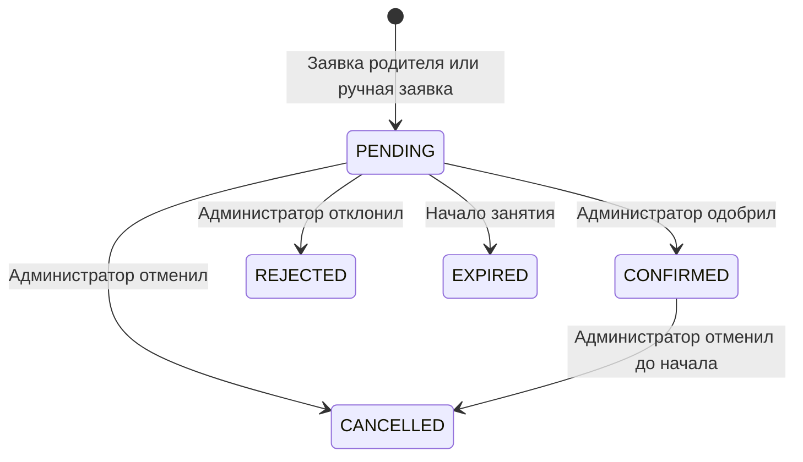
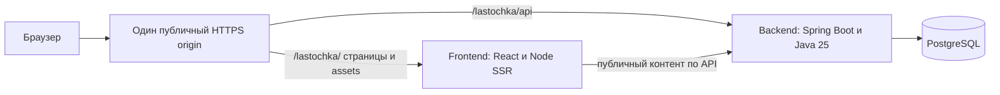

## Context

Мотивация и границы продукта описаны в `proposal.md`. Исходное состояние — материалы
`info/`, `AGENTS.md` и локальный OpenSpec; приложения и существующей БД нет.
Подтверждены родительские аккаунты, отдельные занятия, обязательное одобрение,
один тренер/зал и тестовая SMTP-почта MailHog. Последнее уточнение: WebAuthn обязателен,
пароль сохраняется. Уточнены Java 25, несколько администраторов, единый frontend,
локальная сборка и раздельная поставка frontend/backend на небольшой сервер
с подготовкой к будущему Kubernetes. Временное размещение: сервер
`139.100.236.101`, `https://play-and-say.ru/lastochka/`, затем рабочий сервер. Семь delta-specs
рядом с документом задают поведение.

Этот документ — техническое предложение. Удержание места ожидающей заявкой,
административные отмены/переносы и отсутствие напоминаний — проектные решения
первой версии, отдельно отмеченные в proposal и AGENTS, а не цитаты пользователя.

## Goals / Non-Goals

**Goals:**

- Сохранить инварианты вместимости и одобрения при конкурентных запросах.
- Проверять полный путь регистрации и записи локально без внешних интеграций.
- Сделать контракт API воспроизводимым и обязательным для frontend.
- Разделить модули внутри одного приложения без распределённых транзакций.

**Non-Goals:**

- Не строить универсальную CRM, отдельный identity-сервис и микросервисы.
- Создать отдельную границу модуля payments, но не платёжные операции, сущности
  и интеграцию Play&Say заранее.
- Не считать локальную приёмку подтверждением готовности production или доставки email.

## Decisions

### 1. Репозиторий и стек

Один репозиторий: `frontend/`, `backend/`, `api/openapi.json`, `openspec/`, локальная
конфигурация запуска и документация. Локальный Git инициализирован с веткой `main`
на этапе подготовки репозитория; каркас приложения ещё предстоит создать.
`openspec/`, исходники, миграции, lockfiles, Gradle wrapper и API-артефакты
отслеживаются; `/info/`, `node_modules/`, `.gradle/`, `**/build/`, `**/dist/`,
локальные каталоги артефактов и секреты исключаются через `.gitignore`.
Не использовать общий запрет `*.jar`, скрывающий gradle-wrapper.jar.
Нужные изображения из `info/` копируются/оптимизируются в отслеживаемые ресурсы
frontend, так что чистый checkout собирается без приватных исходных материалов.
Frontend — React 19, TypeScript, Vite, React Router framework mode с SSR публичной
страницы и Node.js LTS runtime. Backend — Kotlin,
Spring Boot 4.1.1, Java 25 (toolchain, JVM target и серверный runtime),
Gradle Kotlin DSL, Spring MVC, Spring Security,
Spring Data JPA, PostgreSQL 17 и Flyway. Точные совместимые версии Kotlin,
Gradle, springdoc и frontend-пакетов фиксируются в первом техническом шаге
и lockfiles; milestone/RC не использовать. Версия Boot ранее проверена
по <https://spring.io/projects/spring-boot/>; совместимость Java — по
<https://docs.spring.io/spring-boot/system-requirements.html>.

Backend — Gradle multi-project modular monolith. Единственный запускаемый модуль
`app` собирает `bootJar`; identity, customers, scheduling, bookings, notifications,
content и payments — отдельные library-модули без собственных серверов и bootJar.
Scheduling владеет занятиями/доступностью ресурсов, bookings — заявками и решениями;
payments изолирован как библиотечный модуль с описанной границей, без активных API
и провайдера в MVP. Состояние записи не содержит статусы оплаты.
`app` выполняет wiring и содержит адаптеры между публичными портами модулей;
доступ к чужим persistence-классам и циклы Gradle-зависимостей запрещены.
Взаимодействие scheduling/bookings для переноса и вместимости выполняется через
порты в общей транзакции, поэтому разбиение не ломает атомарность.
Внутри модулей отдельно API/DTO, application/service, persistence и mapping.
Отдельный catalog не нужен. До Kotlin-кода прочитать `kotlin-spring-boot-structure`.

Альтернативы: отдельные репозитории усложняют атомарное обновление контракта;
микросервисы, Kafka и Redis не требуются для одного расписания и локальной приёмки.

### 2. Единый frontend, собственный SSR и изменяемое наполнение

Лендинг, запись и админка остаются одним frontend-приложением: общий package,
маршруты, стили и API-клиент. Оно собирается и развёртывается отдельно от backend.
JAR содержит только backend, миграции и seed контента; клиентские assets и HTML
в него не копируются. При обновлении интерфейса backend не требуется пересобирать.

Content-модуль backend выдаёт опубликованный `LandingContent` через
`GET /api/v1/public/landing`: schemaVersion, revision, блоки со стабильными id
(hero, approach, formats, first-visit, coach, faq, contacts), тексты,
изображения/alt и метаданные. Документ хранится в PostgreSQL; отслеживаемый seed
используется только при отсутствии данных. Обновления любого приложения
не перезаписывают опубликованное наполнение. Изображения используют публичные
URL/стабильные идентификаторы; JSON не содержит путей внутрь JAR или контейнера.
Стартовые assets поставляются frontend и сохраняют URL при совместимых обновлениях.
Будущий редактор и upload сейчас не реализуются; произвольные HTML/JS запрещены.

Индексируемый HTML теперь формирует frontend-сервис: React Router framework mode
на Vite, SSR через Node.js production runtime. Loader главной читает публичный
документ через типизированный клиент по внутреннему `BACKEND_INTERNAL_URL`,
а React рендерит и затем гидратирует тот же revision. Приватные cookie и сведения
семьи не передаются в публичный SSR-запрос и не попадают в общий кеш/HTML.
Для публичного контента используется revalidation по revision/ETag; постоянного
кеша в памяти отдельной реплики как источника истины нет. Запрос к API ограничен
таймаутом; при недоступности контента frontend отдаёт контролируемый 503, а не
выдуманное содержимое. Серверные переменные и внутренний URL не публикуются
в браузерном bundle. Реализация редактора позднее не требует пересборки frontend.

Это заменяет прежний JVM-шаблон и общий JAR. Статический Nginx без SSR потребовал
бы ослабить требование актуального HTML после изменения контента, а build-only
пререндер привязал бы публикацию текста к новой сборке. Здесь добавляется один
небольшой Node-процесс frontend; компиляция по-прежнему выполняется локально.
Поддержка SSR/отдельной поставки описана в официальной документации:
<https://reactrouter.com/start/framework/deploying>.

Логические UI-маршруты ниже относительны basename `/lastochka` временного окружения:
`/`, `/schedule`, `/auth/*`, `/account/children`, `/account/bookings`,
`/account/security`, `/admin/schedule`, `/admin/requests`, `/admin/families`. Приватные страницы получают только общую HTML-оболочку и загружают
данные клиентом после полного входа; SSR публичной страницы не становится BFF
для регистрации, платежей или авторизации. Доменные команды идут прямо в backend.
Неизвестные API и assets возвращают 404, не HTML приложения. Deep links
обслуживает frontend. Проверенный локальный return path восстанавливает выбранное
занятие после входа, перед заявкой его доступность перечитывается.

Дизайн сохраняет «Воздух», исходные ресурсы и клавиатурные действия. Календари
имеют мобильный список, перенос — доступную форму. Личные данные очищаются
из кеша при выходе. Тестовый режим почты явно обозначается в разрешённых интерфейсах.

### 2.1. Режиссура прокрутки и безопасное усиление интерфейса

Синхронные с прокруткой сцены входят в MVP лендинга. Презентационная подача
в духе Apple достигается связью жеста и визуального изменения, последовательной
композицией и типографикой в палитре «Воздуха». Это требование к публичной странице;
формы входа, запись и админка сохраняют спокойные предсказуемые действия.
Предлагаемый storyboard уточняется при визуальной реализации:

| Сцена | Изменение по локальному прогрессу | Адаптация |
|---|---|---|
| Первый экран | Декоративный акцент плавно переходит от охристого к зелёному, изображение слегка раскрывается/меняет масштаб | На телефоне уменьшается амплитуда, заголовок и CTA постоянно читаемы |
| Подход к занятиям | Короткая закреплённая композиция на широком экране: линия дорисовывается и последовательно выделяет три шага | На телефоне шаги идут обычным вертикальным потоком без длинного pinning |
| Форматы | Карточки и иллюстрации постепенно раскрываются с небольшим сдвигом; акценты следуют продвижению секции | Текст доступен независимо от эффектов, карточки не накладываются |

Важна непрерывность: progress каждой сцены нормализуется в диапазон 0..1,
одинаковая позиция даёт одинаковое состояние и при обратной прокрутке.
IntersectionObserver может включать обработку активной области, но одноразовый
reveal по входу в viewport не заменяет scroll-driven сцены. Колесо/touch/клавиши
не перехватываются, scroll-jacking и принудительная длительность просмотра отсутствуют.
Sticky ограничен собственной секцией; меню, якоря и фокус не оказываются под сценой.

Предпочтительны CSS scroll/view timelines после feature detection; для браузеров
без нужной поддержки — небольшой клиентский fallback с одним requestAnimationFrame
на кадр и обновлением CSS-переменных/стилей активных сцен. Не обновлять React state
и всё дерево на каждый scroll-event. Геометрия измеряется вне горячего цикла
и пересчитывается после изменения размера, загрузки ресурсов/шрифтов и новой
ревизии контента; отключённые/удалённые секции освобождают observers/listeners.
SSR не обращается к window и отдаёт читаемую базовую версию. Enhancement включается
после hydration без несовпадения серверной и клиентской разметки.

Основные эффекты — transform/opacity; изменение цвета и небольшой SVG-штрих
ограничены локальными декоративными элементами. Размеры изображений резервируются,
анимации не меняют поток документа на каждом кадре. Тяжёлые 3D/video-зависимости
не требуются. Если конкретный эффект не укладывается в мобильный бюджет,
упрощается декоративная сцена, а не доступность содержимого.

`prefers-reduced-motion` проверяется и учитывает изменение настройки во время
просмотра: движение останавливается, показывается завершённое состояние,
лишняя высота закреплённой сцены убирается. Без JS/при ошибке enhancement всё
содержимое видно. Семантические тексты не дублируются для скринридера, а декоративные
элементы не становятся доступными для фокуса. Непрозрачность/цвет не делают текст
нечитаемым в промежуточных состояниях; CTA не исчезает из-за прогресса.

LandingContent получает необязательный `motionPreset` из разрешённого enum
по стабильному id блока, например `none`, `hero-reveal`, `approach-story`,
`formats-reveal`. Начальный seed выбирает сцены; frontend содержит их реализацию
и безопасные значения по умолчанию. Не передавать keyframes, JavaScript, raw CSS
или глобальные pixel-offsets через API. Неизвестный пресет трактуется как `none`;
длина текста и перестановка секций не должны требовать переписывать анимации.
Панель редактирования пресетов остаётся будущим этапом вместе с редактором.

Проверка при реализации: зафиксировать кадры 0/25/50/75/100% и обратный ход,
сравнить с заявленным storyboard; проверить 375/1440 пикселей, reduced-motion,
выключенный JS, reload в середине страницы, якорь и изменённую ревизию контента.
Снять browser performance trace на описанной среде с мобильным CPU throttling:
цель — плавность около 60 fps, отсутствие повторяющихся animation-attributable
long tasks >50 ms и layout thrashing. Это бюджет для выбора/упрощения эффектов,
а не обещание одинакового FPS на всех устройствах; результаты измерений записываются.
Механизмы: <https://developer.mozilla.org/en-US/docs/Web/CSS/Guides/Scroll-driven_animations>,
<https://developer.mozilla.org/en-US/docs/Web/CSS/@media/prefers-reduced-motion>.

### 3. Модель данных

| Сущность | Содержимое и ограничения |
|---|---|
| Account | UUID, нормализованный уникальный email, имя, passwordHash, роль, verifiedAt |
| AuthToken | тип VERIFY/RESET, hash токена, accountId, expiresAt, consumedAt |
| WebAuthnUser / Credential | стабильный случайный userHandle, accountId, credentialId, publicKey, signCount, transports, backup flags, label, createdAt, lastUsedAt, revokedAt |
| Child | UUID, parentId, имя, birthDate, archivedAt, version |
| StudioSettings | единственный тренер, зал, зона Europe/Moscow, контакты |
| LandingContent | опубликованный документ: schemaVersion, revision, payload jsonb, updatedAt; seed не перезаписывает существующий документ |
| Session | UUID, название, GROUP/INDIVIDUAL, startsAt/endsAt, capacity, status, version |
| Booking | UUID, childId, sessionId, status, version, createdBy, decision/cancellation reason |
| AuditEvent | агрегат, последовательность, автор/системное действие, время, старые/новые значения |
| IdempotencyRecord | actorId, operation, key, requestHash, исходный HTTP-результат, expiresAt |
| OutboxEvent | eventId, агрегат/последовательность, recipient, payload, Message-ID, attempts, nextAttemptAt, status, acceptedAt, lastError, claim/lease |

Настройки студии и аккаунты администраторов задаются процедурой оператора.
ADMIN — роль многих независимых аккаунтов, не singleton и не синоним тренера.
Каждый использует собственные пароль, passkey и сессии. Процедура создания
поддерживает разные email без изменения существующих аккаунтов.
Нет публичного endpoint для повышения роли, стандартного пароля или demo-аккаунтов
в обычном запуске. Локальная процедура создаёт ADMIN с паролем и разрешением
первой привязки ключа; для доступа к кабинету он также проходит WebAuthn.
Фикстуры существуют только в тестовом профиле.
Детские карточки архивируются вместо удаления. Поля здоровья и диагнозов отсутствуют.
Смена email, объединение семей и доступ второго родителя не входят в эту версию.

### 4. Состояния и правила расписания

Занятие: DRAFT → PUBLISHED ↔ CLOSED; любой будущий нетерминальный статус
может перейти в CANCELLED. Черновики не занимают ресурсы; PUBLISHED/CLOSED занимают
единственного тренера/зал. Изменение времени черновика разрешено, публикация
повторно проверяет пересечения. Интервалы полуоткрытые `[start, end)`.
После начала изменения времени, вместимости, статуса и состава запрещены;
состояние проведения/посещаемость автоматически не придумывается.

PENDING и CONFIRMED учитываются в занятых местах. Это предотвращает ситуацию,
когда несколько ожидающих заявок оказываются одобрены сверх вместимости.
Альтернатива — очередь без удержания мест — потребовала бы листа ожидания
и отдельной обработки отказов при одобрении, которых нет в первом объёме.
TTL удержания до начала занятия: отдельного таймера на несколько часов нет.
Фоновая обработка раз в минуту завершает оставшиеся PENDING в EXPIRED,
включая просроченные во время остановки приложения. Все команды независимо
проверяют текущее время, поэтому задержка обработчика не позволяет одобрение.

Причина обязательна для отклонения и отмены, показывается родителю и ограничена
по длине. Перенос не является отдельным статусом: меняется sessionId записи
или время Session с аудитом и сохранением PENDING/CONFIRMED. Ручная заявка
администратора создаёт PENDING; одобрение остаётся отдельной явной командой.
Закрытие приёма сохраняет занятые места и позволяет решить ранее полученные заявки.
Перенос записи в CLOSED запрещён как новое занятие места; перенос всего CLOSED
занятия допустим с сохранением состава.

Администратор видит занятость и ожидающие заявки; родитель — только свободные
места и собственные записи. Заявка подаётся до startsAt, отдельный ранний cutoff
и напоминания не вводятся. Для отмены/переноса родитель получает контакт тренера.

### 5. Транзакции и конкурентный доступ

Для первого объёма все изменяющие расписание/запись операции берут блокировку
единственной строки StudioSettings через `SELECT FOR UPDATE`, затем перечитывают
затронутые занятия и записи и проверяют version. В эту же дисциплину входят
архивирование ребёнка и завершение PENDING по времени. Это сознательная короткая
сериализация команд одного тренера, включая будущие процессы backend; чтения
расписания и отправка писем не выполняются под блокировкой.

Транзакция проверяет доступ, время, ресурсный интервал, состояние и вместимость,
включая параллельную работу нескольких ADMIN с независимыми accountId,
изменяет запись, пишет аудит и outbox, затем сохраняет результат идемпотентности.
Перенос охватывает исходное и целевое занятие в одной транзакции; отмена занятия
атомарно обновляет все его активные записи. Ошибка откатывает всё.
Идемпотентность проверяется до проверки новой версии для совпадающего сохранённого
запроса, но после проверки текущего аккаунта и прав. Ключ ограничен пользователем
и операцией; срок хранения 24 часа. Отдельная активная запись ребёнка на занятие
дополнительно защищена частичным уникальным индексом для PENDING/CONFIRMED.

Альтернатива с блокировками разных занятий и advisory locks масштабируется лучше,
но усложняет атомарные массовые переносы и порядок блокировок. Для одного зала
глобальная короткая блокировка проще проверяется и достаточна; длительные запросы
под ней запрещены. Один клиентский запрос не может записать сразу несколько детей:
для каждого создаётся отдельная заявка с отдельной идемпотентностью.

### 6. Identity, обязательный WebAuthn и сессии

Spring Security и серверные сессии в PostgreSQL (Spring Session JDBC), cookie
HttpOnly/SameSite=Lax/Secure при HTTPS, ротация идентификатора при входе,
CSRF для всех изменяющих браузерных операций, включая login/logout, token POST
и выдачу/проверку WebAuthn options.
Локальный HTTP разрешает Secure=false только в local-профиле на loopback.
Bearer-токены в localStorage не используются: один браузерный origin делает
cookie-сессии достаточными и позволяет серверный отзыв после сброса пароля.

Регистрация остаётся email/password. До подтверждения доступны `/auth/me`, csrf,
повторное подтверждение и выход. После подтверждения и повторной проверки пароля
аккаунту без ключей доступна только первая привязка WebAuthn. Проверка отсутствия
ключей и сохранение первого ключа выполняются под блокировкой Account; параллельный
устаревший bootstrap не добавляет ещё один ключ после появления первого.
Регистрация ключа не даёт полного входа: нужен отдельный authentication assertion.

Состояния сессии: UNVERIFIED → ENROLLMENT_REQUIRED либо WEBAUTHN_REQUIRED → FULL.
Каждый новый вход PARENT/ADMIN: пароль, затем assertion зарегистрированного ключа
того же аккаунта. Пароль и assertion другого пользователя не объединяются.
Промежуточный этап и challenge живут 5 минут; успешный FULL-вход ротирует session ID.
Неполная сессия не имеет эффективных прав на данные семьи и admin API. MailHog защищается отдельно от сессии приложения.
Сброс пароля отзывает также все неполные сессии, не подтверждает email и не меняет
WebAuthn credentials. Email-ссылка не является фактором входа в кабинет.

Используются `spring-security-webauthn` и штатная поддержка факторов
PASSWORD/WEBAUTHN Spring Security; правила приватного API требуют оба фактора
и подтверждённый email. Для onboarding допускаются только явно перечисленные
ограниченные операции. Не применять условие «MFA только если ключ уже зарегистрирован»
к приватным данным: оно открыло бы кабинет до enrollment. Факт регистрации
credential не подменяет успешную проверку assertion. Криптографическая проверка
делегируется библиотеке, собственная криптография и доверие клиентскому `success`
не допускаются. Поддержка passkeys и MFA проверена:
<https://docs.spring.io/spring-security/reference/servlet/authentication/passkeys.html>,
<https://docs.spring.io/spring-security/reference/servlet/authentication/mfa.html>.

Credential-репозитории сохраняются в PostgreSQL, options/challenge — в серверной
сессии. Для request/response JSON фиксируется base64url. Требуются userVerification
`required`, attestation `none`, discoverable credential; origin и RP ID сверяются
с явной конфигурацией, не с Host запроса. Challenge проверяется и одноразово
потребляется для привязанных аккаунта, сессии и типа create/get, включая ошибочную
попытку; повтор выдачи заменяет прежний challenge. Сервер хранит только public key
и метаданные, signCount обрабатывается библиотекой с учётом синхронизируемых passkey.

Локальный appBaseUrl — `http://localhost:5173/lastochka/`, API проксируется через тот же origin;
для assembled preview — адрес общего локального reverse proxy в отдельной
конфигурации. Браузер никогда не использует внутренний адрес backend.
RP ID — `localhost`, allowedOrigins содержит точный URL выбранного профиля.
Для удалённого preview origin — `https://play-and-say.ru`, RP ID —
`play-and-say.ru`; `/lastochka` не часть origin/RP ID, а IP не используется
для браузерного входа. Браузерный secure context
и доступность WebAuthn проверяются до вызова. Для будущего размещения нужен HTTPS
и устойчивый RP ID: ключ localhost не переносится автоматически на другой домен.
Origin/RP конфиг не расширяется wildcard ради тестов.

Добавление запасного passkey, переименование и отзыв доступны владельцу после
обоих факторов не старше 5 минут; при необходимости запрашивается повторный вход.
Удалить последний ключ нельзя, отзыв немедленно запрещает его использование
и отзывает другие сессии аккаунта. При утрате всех ключей самостоятельное
восстановление в этой версии отсутствует: UI предлагает заранее добавить запасной
ключ и объясняет ограничение. Сброс пароля не открывает повторный bootstrap.
Альтернатива «пароль или passkey» не выполняет обязательность WebAuthn;
полностью беспарольный вход не соответствует решению сохранить пароль.

PasswordEncoder — Argon2id с параметрами, выбранными по локальному измерению;
12–128 символов без молчаливого обрезания. Лимиты входа/почты хранятся в БД:
общий предел по IP и нормализованному аккаунту, конфигурируемые окна/значения.
Публичный текст восстановления и повторной регистрации не раскрывает аккаунт.

Случайные криптографические токены хранятся как хеши, имеют тип/срок и одноразовое
потребление в транзакции. Ссылка открывает страницу и требует явного POST:
простой GET от сканера писем токен не расходует. Значение передаётся во fragment,
убирается из адресной строки после чтения и не попадает в серверные access logs.
URL строится из настроенного appBaseUrl, а не входного Host. Страницы токенов
не подключают внешнюю аналитику. Обычные логи не содержат пароли, токены или тела писем.

### 7. Тестовая почта MailHog и outbox

В local/test и закрытом preview backend notifications отправляет письма по SMTP
в отдельный MailHog. Это заменяет DB mock sink и собственный `/dev/mailbox`.
Формирование сообщения и интерфейс доставки отделены от SMTP-адаптера; frontend
не отправляет письма. Сценарии регистрации/сброса остаются полноценными, без
обхода подтверждения email или обязательного WebAuthn.

Установка входит в задачи реализации: отдельный Compose-сервис MailHog локально
и в плане тестового развёртывания на `139.100.236.101`. Использовать готовый образ,
при реализации проверить версию/digest и архитектуру локальной машины/сервера;
на сервере ничего не собирать. Внутри сети backend использует `mailhog:1025`;
параметры SMTP задаются конфигурацией backend с ограниченными timeout.
SMTP-порт не публикуется наружу; для backend на хосте разрешён только loopback.
Web UI/API на 8025 публикуется на loopback, на сервере доступен оператору через
SSH-туннель. Он не проксируется в публичный `/lastochka/` и не использует сессию
ADMIN приложения: доступ защищается отдельно правами SSH. Автотесты читают
MailHog HTTP API внутри тестовой среды. Реальные данные семей не используются.

Для сохранения захваченных писем при перезапуске выбрать `MH_STORAGE=maildir`,
`MH_MAILDIR_PATH` и отдельный volume Lastochka; MongoDB для этого не нужна.
Задать очистку тестовых писем и контроль размера volume в инструкции оператора.
Содержимое и ссылки с токенами не выводятся в логи. Не настраивать outgoing SMTP
и не использовать release; поскольку MailHog допускает ручную пересылку из UI,
его исходящий доступ во внешние сети закрывается на уровне сети контейнера.
Официальные настройки проверены 18 октября 2026 года:
<https://github.com/mailhog/MailHog>,
<https://github.com/mailhog/MailHog/blob/master/docs/CONFIG.md>.

Outbox создаётся в транзакции регистрации/сброса/изменения записи. Worker после
commit отправляет событие в MailHog и сохраняет попытку/результат в PostgreSQL.
Один eventId обозначает одно логическое уведомление; Message-ID стабилен для его
повторов. Захват MailHog после SMTP acceptance не означает внешнюю доставку.
SMTP и commit результата не атомарны: потеря ответа после приёма письма или сбой
до сохранения результата допускают повторный захват. Message-ID помогает связать
копии, но не гарантирует дедупликацию MailHog. Уже отмеченные успешными события
повторно не отправляются; бизнес-изменение повтором письма не выполняется.
У worker есть claim/lease и последовательная обработка событий одной записи,
без параллельной отправки одного eventId. Задержки повторов: 5, 30, 120, 600 секунд,
затем FAILED после пятой неудачной попытки. Причина, eventId и число попыток
доступны оператору в закрытой диагностике без тела письма и токенов.
Очередь и результаты переживают замену backend независимо от MailHog volume.

Письма отражают событие и его время, содержат ссылку на актуальную запись;
отложенное письмо не выдаёт старый статус за текущий. Для переноса Session
создаётся событие на каждую затронутую Booking, включая ожидающие заявки.
Сбой SMTP не отменяет уже сохранённую запись; недоступный MailHog не заменяется
отправкой через RuSender. Ссылки используют PUBLIC_APP_URL с `/lastochka/`.
Родитель проверяет скопированную из MailHog ссылку в собственной браузерной сессии.
Production-профиль запрещает тестовую MailHog-доставку; боевой запуск требует
отдельного подключения реальной почты. В этом planning-изменении сервис не установлен.

Провайдер будущей реальной доставки — **RuSender**, транзакционный HTTPS Email API
из backend notifications: <https://rusender.ru/developer/api/email/>.
Будут нужны API-токен, активный ключ отправки и верифицированный домен/адрес.
Плановый отдельный адаптер использует eventId как основу идемпотентности; принятие
API не считается доставкой адресату, статусы/повторы уточняются при подключении.
Секреты передаются backend извне; для сборки и MailHog-приёмки они не нужны.
Реальная отправка и массовые рассылки в эту версию не входят.

### 8. API и генерация

Backend controllers и DTO — источник OpenAPI. springdoc генерирует стабильный
`api/openapi.json`; `openapi-typescript` генерирует схемы, `openapi-fetch`
даёт типизированные пути/методы. Классы persistence не становятся DTO.
Для форм допускаются отдельные UI-модели с явным преобразованием в API-типы.

Логические пути контроллеров ниже относительны backend context path. Во временном
окружении context path — `/lastochka`, внешний API — `/lastochka/api/v1`;
типизированный клиент соединяет этот base URL и логические OpenAPI paths.
Экспорт не зашивает IP/временный домен в transport DTO.

| Логическая область `/api/v1` | Основные операции |
|---|---|
| `/public/landing` | опубликованное типизированное наполнение, schemaVersion/revision/ETag |
| `/auth` | csrf, register, password-stage, logout, me с этапом входа, verify-email, resend-verification, forgot-password, reset-password |
| `/auth/webauthn` | registration options/finish, authentication options/finish, список/название/отзыв credentials |
| `/children` | список, создание, редактирование, архивирование своих детей |
| `/sessions` | публичный список по диапазону дат и карточка занятия |
| `/bookings` | подать заявку, список/карточка своих записей |
| `/admin/sessions` | черновик, редактирование, публикация/открытие, закрытие, перенос, отмена |
| `/admin/bookings` | очередь/история, ручная заявка, approve, reject, transfer, cancel |
| `/admin/families` | поиск существующего родителя и его детей для ручной записи |

Пути команд уточняются при экспорте контракта в рамках этой структуры.
Все изменяющие команды расписания/записи принимают Idempotency-Key; команды
изменения сущности — expectedVersion. Даты/время — ISO 8601 UTC, birthDate — date,
зона студии отдельным полем; ошибки — ProblemDetail с code/requestId/fieldErrors.
Родительские запросы берут владельца из Principal, доступ к чужим ID даёт 404.
Проверяется полнота обоих факторов, а не только `isAuthenticated`.

Списки: page/size, size по умолчанию 20 и максимум 100; диапазон публичного
расписания ограничен 93 днями. Сортировки документируются, UUID добавляется
последним ключом для устойчивого порядка. Основные коды: CAPACITY_EXCEEDED,
SESSION_UNAVAILABLE, SCHEDULE_CONFLICT, DUPLICATE_BOOKING, VERSION_CONFLICT,
INVALID_TOKEN, VALIDATION_ERROR и RATE_LIMITED.

CI запускает backend на чистой тестовой БД с фиксированной конфигурацией,
экспортирует и нормализует OpenAPI (без timestamp и случайных server URL),
перегенерирует типы, проверяет отсутствие diff артефактов, typecheck и сборку.
Изменения DTO требуют совместного обновления контракта и frontend в одном PR.
Альтернатива ручных типов не даёт автоматической связи, а schema-first дублирует
описание DTO, когда пользователь выбрал источник истины на backend.

### 9. Проверка и приёмка

Интеграционные тесты используют настоящий PostgreSQL, не H2: важны блокировки,
уникальные индексы и транзакции. Параллельные запросы проверяют последнее место,
гонку решений, перенос, публикацию пересекающихся занятий и архивирование ребёнка.
Управляемые часы проверяют TTL и границу startsAt без ожидания реального времени.

Браузерный сценарий проходит регистрацию с письмом в MailHog, подтверждение, привязку
passkey и вход обоими этапами, двух детей, заявку, одобрение во второй полной
сессии администратора, перенос,
отклонение/отмену и восстановление пароля с отзывом старой сессии. Отдельно
проверяются изоляция семей, CSRF, приватность ящика, сбой доставки/перезапуск,
серверный HTML без JS, клавиатура и визуальное соответствие «Воздуху» на двух размерах.
Для контента тестовая фикстура заменяет опубликованный документ в БД: следующий
HTML/JSON и React показывают новый revision без пересборки; обновления сервисов не откатывают
изменённое наполнение. Это тест адаптера, не реализация будущей панели.
WebAuthn проверяется виртуальным аутентификатором браузера с реальными create/get
и серверной проверкой, а не заглушкой успешного входа. Негативные проверки:
истёкший/replay challenge, чужой credential, неверный origin/RP, отмена и отсутствие
user verification, попытка доступа после одного пароля и сброса пароля.
Приёмку виртуального устройства отдельно отличать от ручной проверки системного
passkey/биометрии на физическом устройстве.

### 10. Раздельная поставка и путь к Kubernetes

Две независимые локальные сборки и версии: backend — Java 25 JAR с embedded
servlet server, модулями, seed и миграциями; frontend — production Node SSR bundle
и клиентские assets. Backend собирается и запускается без frontend. Frontend
использует сохранённый контракт OpenAPI и не требует backend-процесса при сборке.
Обновление типов — отдельный явный шаг после изменения контракта, не скрытый
запуск полного приложения во время каждого frontend build.

Для поставки подготовить два OCI-образа `lastochka-backend:<version>` и
`lastochka-frontend:<version>` с независимыми digest/версиями. Образы собираются
локально под Linux/архитектуру сервера; на сервер передаются/загружаются готовыми.
Там нужны container runtime, внешняя конфигурация и PostgreSQL, а не Gradle,
Vite, исходники или build-зависимости. Java и Node runtime включены в свои образы.
Один репозиторий не означает одну единицу развёртывания.

Первый сервер — `139.100.236.101`, временный публичный URL —
`https://play-and-say.ru/lastochka/`. Это параметры назначения; текущее состояние
DNS, TLS и proxy ещё не проверено. Приложение — отдельный Compose project
с именами/сетями/конфигурацией и данными Lastochka. PostgreSQL использует отдельную
БД/пользователя и постоянное хранилище, не БД Play&Say. Compose использует
готовые images без `build:`. Перед реальным развёртыванием изучить текущий
proxy/runbook общего сервера и сохранить рабочие маршруты существующего сайта.

Публичный origin один, но namespace приложения ограничен `/lastochka/`:
- точный `/lastochka` нормализуется в `/lastochka/` с query;
- `/lastochka/api/**` направляется в backend с сохранением префикса;
- остальные страницы и assets внутри `/lastochka/` направляются во frontend;
- корневой `/api`, главная Play&Say и `/lastochka-other` не переназначаются.
Backend context path — `/lastochka`, controller paths остаются `/api/v1`.
Прокси не снимает prefix повторно; forwarded headers принимаются только от
известного прокси. Браузерный API base — `/lastochka/api/v1` с корректной
композицией base/path; внутренний SSR base — например,
`http://backend:8080/lastochka`, без публикации его в bundle.

`APP_BASE_PATH=/lastochka` и
`PUBLIC_APP_URL=https://play-and-say.ru/lastochka/` — единые входы конфигурации.
Они определяют React Router basename, asset base Vite, SSR routes/links,
API base, canonical/OG URLs, email-ссылки и безопасный return path. К корню
Play&Say не должны обращаться даже lazy chunks, CSS fonts/images и ответы redirect.
Build-time base frontend фиксируется в release metadata и проверяется против
runtime prefix; смена подпути может потребовать новую frontend-сборку с другой
конфигурацией, но не изменения исходного кода. Backend prefix меняется конфигурацией.
Относительные asset IDs из LandingContent разрешаются с текущей базой;
временный host не сохраняется как неизменяемый путь к ресурсу в БД.

Сессия — cookie `LASTOCHKA_SESSION` с Path `/lastochka`, Secure/HttpOnly,
SameSite=Lax, без Domain; CSRF-cookie, если используется, получает отдельное имя
и тот же Path. Не использовать `__Host-` cookie с этим Path и не переиспользовать
cookie Play&Say. WebAuthn допускает только credentialId данного аккаунта Lastochka;
название RP отличает временное приложение в диалоге устройства. Cookie Path и
URL-prefix не являются границей изоляции JavaScript между приложениями одного
origin, поэтому preview остаётся средой с синтетическими данными.
Документация механизмов basename/base и RP:
<https://reactrouter.com/api/framework-conventions/react-router.config.ts>,
<https://vite.dev/config/shared-options.html#base>,
<https://developer.mozilla.org/en-US/docs/Web/API/PublicKeyCredentialCreationOptions>.

Раздельный деплой требует совместимости: контракт `/api/v1` и schemaVersion
контента изменяются аддитивно; предыдущий frontend должен работать с новым backend
в пределах текущего rollout. Сначала выпускается совместимый backend, затем
frontend; удаление старых полей/поведения откладывается на последующий выпуск.
Новая frontend-версия выпускается только после проверки её требований к API;
матрица совместимости фиксируется у артефактов. Откат frontend не требует отката
backend. Откат backend допускается только при совместимости с активным frontend
и миграциями БД. Старые hashed assets сохраняются на окно rollout, чтобы открытые
вкладки не теряли chunks; это проверяется и для будущей маршрутизации реплик.

Оба процесса завершаются по SIGTERM и имеют отдельные health/readiness проверки.
Backend liveness не зависит от доступности БД; readiness учитывает БД/миграции.
Frontend liveness проверяет свой runtime; готовность HTML-маршрутов контролируется
без бесконечных рестартов при сбое API. Пользовательские данные, сессии,
credentials, идемпотентность и outbox находятся в PostgreSQL, не локальных файлах
контейнеров. API не опирается на sticky sessions; challenge потребляется атомарно
в общем хранилище, а worker координируется БД. Логи идут в stdout/stderr,
конфигурация/секреты внешние, лимиты памяти/пулы задаются при запуске.

Будущий Kubernetes сохраняет эти же два образа: отдельные Deployments/Services
и Ingress с теми же путями/публичным доменом. Миграции выносятся в один управляемый
шаг перед rollout, если появятся несколько backend-реплик; БД не становится
эфемерной частью Pod. Сейчас Kubernetes-кластер, manifests/Helm и HA-развёртывание
не создаются. Переход не должен требовать переписывать бизнес-модули; готовность
нескольких реплик и zero-downtime подтверждается отдельно при фактическом переходе.

В текущем изменении проверить локальную поставку и независимую замену каждого
образа с сохранением данных, контента и публичного origin. Фактическое размещение
на `139.100.236.101` требует доступа, проверки текущих настроек и отдельного запроса. Preview остаётся
с MailHog; реальные клиенты/внешняя доставка — следующий этап.

### 10.1. Последующий перенос на рабочий сервер

Переносятся совместимые образы, PostgreSQL (включая credentials/content/outbox),
конфигурация и требуемые ресурсы. Перед переключением фиксируются версии,
делаются backup/restore-проверка и короткая остановка изменяющих операций для
финальной согласованной копии. Старое и новое окружения не должны независимо
отправлять одну очередь либо принимать расходящиеся записи. После проверки
health, маршрутов, входа и бронирования переключается upstream/DNS; старое
окружение сохраняется для контролируемого rollback с учётом новых записей.

Если публичный домен/путь сохраняются через прокси, меняется адрес upstream,
а RP ID/пользовательские ссылки остаются прежними. Если выбирается новый домен,
его имя и origin/RP согласуются до переключения: passkey для play-and-say.ru
не считаются переносимыми автоматически. Нужен отдельный план регистрации ключей
на новом домене, с доступностью старого окружения и проверкой обоих факторов,
либо начало новой тестовой среды. Один сброс пароля не заменяет WebAuthn.
Конкретная миграция пользователей на новый домен не включается молча в MVP.

## Risks / Trade-offs

- Ожидающие заявки удерживают места до начала → очередь администратора показывает
  число ожидающих и ближайшее время; отклонение сразу освобождает место.
- Единственная блокировка ограничивает частоту команд → транзакции короткие,
  письма и сеть за их пределами; масштабирование рассматривается при росте студии.
- MailHog содержит рабочие ссылки доступа → закрытый UI/API через loopback/SSH,
  изолированный SMTP без внешней пересылки, отсутствие содержимого в логах,
  production guard и синтетические данные; сессия ADMIN не защищает отдельный сервис.
- Будущий редактор может рассинхронизировать SEO и React → общий опубликованный
  документ/revision для HTML и JSON, без независимого build-only снимка.
- Маленький сервер ограничен памятью → локальная сборка двух образов, измерение
  суммарной памяти Java/Node/proxy/PostgreSQL/MailHog и отдельные лимиты; не обещать
  пригодность для неизвестного размера сервера без измерений.
- Независимые обновления могут рассинхронизировать API и assets → матрица
  совместимости, аддитивные изменения и сохранение старых chunks на окно rollout.
- WebAuthn требует устройства с поддержкой и устойчивого RP ID → объяснить
  ограничения, поддержать запасные ключи; реальный origin проверить перед выпуском.
- Потеря всех passkey не лечится сбросом пароля → показать это до регистрации
  и не заявлять самостоятельное восстановление ключей как готовую возможность.
- Версии зависимостей документально совместимы, но ещё не собраны → первый этап
  проверяет минимальную сборку и экспорт схемы до реализации предметных модулей.
- Точные адрес/тарифы неизвестны → предусмотрены корректные нейтральные тексты,
  выпуск публичного production с реальными данными является отдельным этапом.

## Migration Plan

1. При реализации создать многомодульную структуру, правила Git, зафиксировать
   Java 25/зависимости, PostgreSQL и последовательные миграции с нуля.
2. Создать нужное число администраторов процедурой оператора, привязать их passkey;
   поднять local-профиль с MailHog и проверить health/API-контракт.
3. Выполнить интеграционную и браузерную приёмку на синтетических данных;
   сохранить команды запуска и результат в проектной документации.
4. Локально собрать два независимых образа, проверить Compose-запуск без сборки
   на сервере и подготовить доставку, backup, health-check и отдельный rollback
   каждого сервиса с проверкой совместимости.
5. Фактическое размещение на `139.100.236.101` под `/lastochka/` выполнить
   по отдельному запросу после проверки доступа/proxy и окружения. Будущий рабочий
   сервер переносится по плану 10.1. Реальная почта и production-приёмка — отдельно.

Откат: заменить только выбранный сервис предыдущей совместимой версией,
проверить readiness и связи с другой частью. Миграции не удаляют данные автоматически.
До несовместимой миграции
делать резервную копию; восстановление из копии выполнять только осознанно.
Пересоздавать можно лишь явно обозначенную одноразовую тестовую БД.

## Open Questions

- Точный адрес, действующие цены и окончательные тексты контактов можно подставить
  позже без изменения API, схемы данных и сценариев записи.
- Временные IP и публичный URL заданы. Для реального развёртывания остаются
  SSH-доступ, ОС/CPU-архитектура, ресурсы и актуальная proxy-конфигурация.
- Адрес рабочего сервера и его окончательный публичный домен/подпуть пока неизвестны;
  они определяют фактическое переключение и необходимость нового WebAuthn enrollment.
- RuSender выбран; конкретные API-токен, ключ отправки, домен/адрес отправителя
  и приёмка реальной доставки относятся к последующему подключению, не к тестовому MVP с MailHog.

## Уточнения реализации и проверок — 19.10.2026

- Параметры WebAuthn challenge сохраняются отдельно в PostgreSQL, одноразовое
  потребление — отдельная транзакция, включая неуспешную проверку. Серверные
  библиотечные options сериализуются ограниченным allowlist codec; данные браузера
  этим codec не десериализуются. Credential/private key остаётся у аутентификатора.
- Серверные сессии имеют authVersion: смена пароля и отзыв ключа отзывают старые
  сессии, включая запросы, пересекающиеся со сбросом. Сброс не удаляет passkey.
- При переносе всего занятия увеличиваются версии затронутых записей. Устаревшая
  форма решения не применяет действие к уже перемещённой записи.
- MailHog находится в internal Docker network. Для loopback UI/SMTP используется
  отдельный входящий Nginx relay: публикация порта самого internal-сервиса не даёт
  требуемой связности Docker Desktop. MailHog по-прежнему не имеет внешнего egress.
  Результат старой SMTP-попытки не перезаписывает более новый claim.
- Сцены и условия CPU-бюджета описаны в `docs/scroll-storyboard.md`;
  доставка/откат/перенос — в `docs/deployment/README.md`. Серверный vhost получает
  только отдельный Lastochka location, закрытый basic auth. Корень, RepairDevice,
  ACME и TLS общего сервера сохраняются.
- Production профиль fail-fast до Flyway, пока нет реальной доставки RuSender.
  HTTPS/RP можно проверить локально через `compose.https-test.yaml`; это отдельная
  имитация с тестовым сертификатом, не подтверждение публикации на общем сервере.

- Identity предоставляет модулю bookings неизменяемую AccountProfile; JPA Account,
  пароль и credential-репозитории не передаются через эту границу. Правило
  зафиксировано в AGENTS.md и проверено повторной чистой backend-сборкой.
